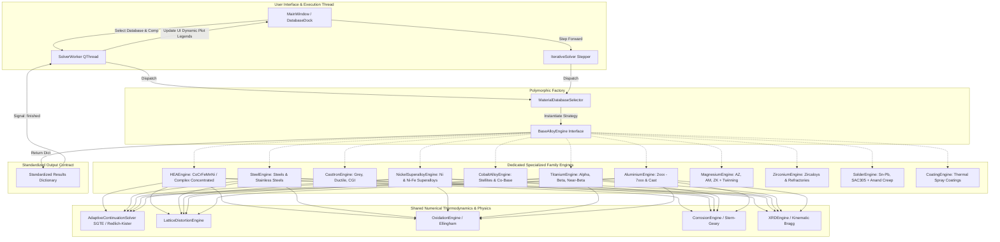

# RFC: Multi-Alloy Family Backend Engines Architecture

## 1. Context & Problem Statement

The computational materials application currently provides access to 14 distinct alloy databases within the user interface:
1. High-Entropy Alloys (`unified_hea_database.py`)
2. General Steels (`general_steel_database.py`)
3. Stainless Steels (`stainless_steel_database.py`)
4. Cast Irons (`cast_iron_database.py`)
5. Nickel-Based Superalloys (`nickel_superalloy_database.py`)
6. Ni-Fe-Based Superalloys (`nife_superalloy_database.py`)
7. Cobalt-Based Alloys (`cobalt_database.py`)
8. Titanium Alloys (`titanium_database.py`)
9. Aluminium Alloys (`aluminium_database.py`)
10. Magnesium Alloys (`magnesium_database.py`)
11. Zirconium Alloys (`zirconium_database.py`)
12. Refractory & Single Crystal Alloys (`single_crystal_database.py`)
13. Solders & Low-Melting Alloys (`solder_database.py`)
14. Thermal Spray Coatings (`thermal_spray_database.py`)

### The Architectural Defect
Within [`pycalphad_app/gui/worker.py`](file:///c:/Users/Dell/Documents/Material%20design/pycalphad_app/gui/worker.py), only `"Thermal Spray Coatings"` is routed to a dedicated physics engine ([`CoatingEngine`](file:///c:/Users/Dell/Documents/Material%20design/pycalphad_app/core/coating_engine.py)). All other 13 alloy databases are channeled through a single generic transition-metal HEA solver ([`ThermoEngine`](file:///c:/Users/Dell/Documents/Material%20design/pycalphad_app/core/thermo_engine.py) / [`PyCalphadEmbed`](file:///c:/Users/Dell/Documents/Material%20design/pycalphad_app/core/pycalphad_embed.py)).

This creates critical physical errors when simulating non-HEA systems:
- **Aluminium Alloys (e.g. AA 7075-T6)**: Erroneously predicted as body-centred cubic ($\text{BCC } A2$) instead of face-centred cubic ($\text{FCC } A1$); missing age-hardening precipitation kinetics ($\eta'\text{-MgZn}_2$, $S$-phase, $\theta'$), GP zones, and Orowan bowing.
- **Steels & Stainless Steels**: Lacks martensite start/finish transformation kinetics ($M_s, M_f$ via Andrews and Koistinen-Marburger), bainite reaction cessation ($B_s$ via Bhadeshia), and carbide sequence evolution ($MC, M_{23}C_6$).
- **Cast Irons**: Unable to model the competitive eutectic growth between stable graphite ($\gamma + \text{Gr}$) and metastable ledeburite ($\gamma + \text{Fe}_3\text{C}$).
- **Titanium Alloys**: Missing allotropic $\alpha/\beta$ transus calculation ($T_\beta$), equivalent stabilizer partitioning ($[\text{Al}]_{\text{eq}}, [\text{Mo}]_{\text{eq}}$), and hexagonal/orthorhombic martensites ($\alpha', \alpha''$).
- **Nickel & Ni-Fe Superalloys**: Missing coherent $\gamma'$ solvus, volume fraction scaling, lattice misfit parameter ($\delta$), and New PHACOMP $d$-orbital ($\bar{M}_d$) TCP phase suppression.
- **Magnesium Alloys**: Missing hexagonal close-packed (HCP) non-basal twinning asymmetry ($\sigma_y^{\text{tension}} \neq \sigma_y^{\text{compression}}$) and discontinuous $\beta\text{-Mg}_{17}\text{Al}_{12}$ cellular precipitation.
- **Solders**: Missing eutectic reaction modeling and Anand viscoplastic constitutive behavior for thermal-fatigue creep.

---

## 2. Explicit Non-Goals

1. **Non-Goal 1**: Re-implementing commercial closed-source binary databases (e.g., Thermo-Calc TCFE/TCNI) directly; instead, we implement peer-reviewed SGTE unaries, verified Redlich-Kister excess parameters, and standard metallurgical constitutive formulations.
2. **Non-Goal 2**: Spatial 3D finite-element mesh rendering inside the core engines; spatial field integration is delegated to downstream FEA solvers via the existing export cards.
3. **Non-Goal 3**: Replacing the newly engineered `AdaptiveContinuationSolver`; rather, the continuation solver serves as the shared Gibbs minimization foundation underpinning each alloy family engine.

---

## 3. System Architecture & Component Design



### 3.1 Abstract Base Interface (`BaseAlloyEngine`)
Located at [`pycalphad_app/core/base_alloy_engine.py`](file:///c:/Users/Dell/Documents/Material%20design/pycalphad_app/core/base_alloy_engine.py):

```python
class BaseAlloyEngine(ABC):
    """
    Polymorphic foundation for all alloy family calculation engines.
    Guarantees strict lifecycle compliance and data contract standardization.
    """
    # Deterministic Process-to-Cooling-Rate mapping
    COOLING_RATES: Dict[str, float] = {
        "Arc Melt / Cast": 1.5,
        "Casting": 1.5,
        "Wrought / Annealed": 0.5,
        "Forging": 2.0,
        "Heat Treated / Quenched": 80.0,
        "Water Quench": 150.0,
        "HVOF": 1e6,
        "Plasma Spray": 1e6,
        "Laser Clad / DED": 1e3,
    }

    def __init__(self, database_name: str, composition_wt: Dict[str, float], 
                 grain_size_um: float = 25.0, process_type: str = "Wrought"):
        self.database_name = database_name
        self.comp_wt = self._normalize(composition_wt)
        self.grain_size_um = max(0.1, grain_size_um)
        self.process_type = process_type
        self.comp_at = self._convert_to_atomic(self.comp_wt)
        self.base_element = self._resolve_base_element()
        self.cooling_rate_k_s = self.COOLING_RATES.get(process_type, 5.0)

    @abstractmethod
    def get_supported_phases(self) -> List[str]:
        """Returns the primary crystallographic and precipitate phases."""
        pass

    @abstractmethod
    def compute_thermodynamics(self) -> Dict[str, Any]:
        """Calculates solidus, liquidus, freezing range, and phase fractions."""
        pass

    @abstractmethod
    def compute_phase_transformations(self) -> Dict[str, Any]:
        """Calculates kinetic boundaries: Ms, Mf, Bs, transus, or solvus."""
        pass

    @abstractmethod
    def compute_mechanical_properties(self, thermo_state: Dict[str, Any], 
                                     transform_state: Dict[str, Any]) -> Dict[str, Any]:
        """Calculates yield strength, UTS, elongation, hardness, and fracture toughness."""
        pass

    @abstractmethod
    def compute_transport_properties(self, thermo_state: Dict[str, Any]) -> Dict[str, Any]:
        """Calculates temperature-dependent density, CTE, and thermal conductivity."""
        pass

    @abstractmethod
    def compute_environmental_properties(self, thermo_state: Dict[str, Any]) -> Tuple[Dict[str, Any], Dict[str, Any]]:
        """Calculates high-temperature oxidation (Wagner) and corrosion kinetics."""
        pass

    @abstractmethod
    def compute_single_temperature_step(self, temperature_k: float) -> Dict[str, Any]:
        """Calculates discrete instantaneous state for interactive step execution."""
        pass
```

---

## 4. Family Engine Specifications & Physical Formulations

### 4.1 Steel & Stainless Steel Engine (`SteelEngine`)
* **Phases**: Austenite ($\gamma$, FCC), Ferrite ($\alpha$, BCC), Martensite ($\alpha'$, BCT), Pearlite ($\alpha + \text{Fe}_3\text{C}$), Cementite ($\text{Fe}_3\text{C}$), Carbides ($M_{23}C_6$, $M_7C_3$, $MC$), $\delta$-ferrite, and $\sigma$-phase.
* **Martensite Kinetics**:
  - Andrews Linear Formula:
    $$M_s \,(^\circ\text{C}) = 539 - 423[\text{C}] - 30.4[\text{Mn}] - 17.7[\text{Ni}] - 12.1[\text{Cr}] - 7.5[\text{Mo}]$$
  - Koistinen-Marburger Equation for athermal transformation:
    $$f_{\alpha'}(T) = 1 - \exp\big(-0.011 (M_s - T)\big) \quad (T < M_s)$$
* **Bainite Kinetics**:
  - Steven & Haynes formulation:
    $$B_s \,(^\circ\text{C}) = 830 - 270[\text{C}] - 90[\text{Mn}] - 37[\text{Ni}] - 70[\text{Cr}] - 83[\text{Mo}]$$
* **Strengthening Mechanics**:
  - Hall-Petch boundary strengthening: $\Delta \sigma_{gb} = k_y d^{-1/2}$ ($k_y \approx 0.55 \text{ MPa}\cdot\text{m}^{1/2}$).
  - Carbon interstitial solid-solution strengthening: $\Delta \sigma_{\text{ss}} = 4670 [\text{C}]^{1/2} \text{ MPa}$.
  - Dislocation substructure: $\Delta \sigma_\rho = M \alpha G b \sqrt{\rho}$.

### 4.2 Cast Iron Engine (`CastIronEngine`)
* **Phases**: Ferrite, Pearlite, Austenite, Free Graphite (Flake, Nodular/Spheroidal, Compacted), Ledeburite ($\text{Fe}_3\text{C}$ eutectic).
* **Graphitization vs Ledeburite Solidification**:
  - Carbon Equivalent:
    $$\text{CE} = [\text{C}] + \frac{[\text{Si}] + [\text{P}]}{3}$$
  - Silicon partitioning promotes stable graphite eutectic ($T_{\text{eut}} \approx 1153^\circ\text{C}$) over metastable white iron ledeburite ($T_{\text{eut}} \approx 1148^\circ\text{C}$).
  - Inoculation and nodularity rating ($N_{\text{nod}} \in [0, 100\%]$) based on $\text{Mg}$ and $\text{Ce}$ residuals ($[\text{Mg}]_{\text{res}} \ge 0.035 \text{ wt.\%}$ yields spheroidal graphite).

### 4.3 Nickel & Ni-Fe Superalloy Engine (`NickelSuperalloyEngine`)
* **Phases**: Matrix ($\gamma$, FCC), Coherent ordered $\gamma'$ ($L1_2$, $\text{Ni}_3(\text{Al,Ti,Ta})$), $\gamma''$ ($D0_{22}$, $\text{Ni}_3\text{Nb}$ in Inconel 718), Carbides ($MC, M_{23}C_6, M_6C$), Topologically Close-Packed (TCP: $\sigma, \mu$, Laves).
* **Solvus & Volume Fraction**:
  - Calibrated thermodynamic $\gamma'$ solvus:
    $$T_{\text{solv}} \,(^\circ\text{C}) \approx 950 + 45.2[\text{Al}] + 36.8[\text{Ti}] + 18.5[\text{Ta}] + 12.1[\text{Nb}] - 4.5[\text{Co}] - 2.8[\text{Cr}]$$
  - Volume fraction $f_{\gamma'}$ progression to $60-70\%$ at operating temperatures.
* **Lattice Misfit & Rafting**:
  $$\delta = 2 \left( \frac{a_{\gamma'} - a_\gamma}{a_{\gamma'} + a_\gamma} \right)$$
* **TCP Stability (New PHACOMP)**:
  $$\bar{M}_d = \sum_{i=1}^N x_i (M_d)_i$$
  TCP embrittlement warning triggered if $\bar{M}_d > 0.985$.

### 4.4 Titanium Alloy Engine (`TitaniumEngine`)
* **Phases**: $\alpha$ (HCP, A3), $\beta$ (BCC, A2), Martensite $\alpha'$ (hexagonal), $\alpha''$ (orthorhombic), $\text{Ti}_3\text{Al}$ ($\alpha_2$), $\text{TiAl}$ ($\gamma$).
* **$\beta$-Transus Temperature ($T_\beta$)**:
  $$T_\beta \,(^\circ\text{C}) = 882 + 21.1[\text{Al}] - 9.5[\text{Mo}] - 6.9[\text{V}] - 11.8[\text{Cr}] - 15.4[\text{Fe}] + 4.2[\text{Sn}] + 1.2[\text{Zr}] + 513[\text{O}] + 700[\text{N}]$$
* **Stabilizer Equivalents**:
  $$[\text{Al}]_{\text{eq}} = [\text{Al}] + \frac{[\text{Sn}]}{3} + \frac{[\text{Zr}]}{6} + 10[\text{O} + \text{C} + 2\text{N}]$$
  $$[\text{Mo}]_{\text{eq}} = [\text{Mo}] + \frac{[\text{V}]}{1.5} + \frac{[\text{Nb}]}{3.6} + \frac{[\text{Ta}]}{5} + 1.25[\text{Cr}] + 2.5[\text{Fe}] + 2.9[\text{Ni}]$$
* **Classification**: $\alpha$ ($[\text{Mo}]_{\text{eq}} < 2$), $\alpha+\beta$ ($2 \le [\text{Mo}]_{\text{eq}} \le 10$), near-$\beta$ / metastable-$\beta$ ($[\text{Mo}]_{\text{eq}} > 10$).

### 4.5 Aluminium Alloy Engine (`AluminiumEngine`)
* **Phases**: $\alpha$-Al (FCC), GP Zones, $\eta' / \eta$ ($\text{MgZn}_2$ in 7xxx), $\theta' / \theta$ ($\text{Al}_2\text{Cu}$ in 2xxx), $\beta'' / \beta$ ($\text{Mg}_2\text{Si}$ in 6xxx), $S$-phase ($\text{Al}_2\text{CuMg}$), Dispersoids ($\text{Al}_3\text{Zr}$, $\text{Al}_{20}\text{Cu}_2\text{Mn}_3$).
* **Precipitation Hardening (Kampmann-Wagner Numerical / Orowan Transition)**:
  - Dislocation shearing for under-aged precipitates ($r < r_c$):
    $$\Delta \tau_{\text{shear}} \propto f_p^{1/2} r^{1/2}$$
  - Orowan looping for peak/over-aged precipitates ($r > r_c$):
    $$\Delta \tau_{\text{Orowan}} = \frac{0.81 M G b}{2\pi \sqrt{1-\nu}} \frac{\ln(2\bar{r}/r_0)}{\lambda - 2\bar{r}}$$

### 4.6 Magnesium Alloy Engine (`MagnesiumEngine`)
* **Phases**: $\alpha$-Mg (HCP), $\beta\text{-Mg}_{17}\text{Al}_{12}$, Laves phases ($C14, C15, C36$), $\text{MgZn}$, $\text{Mg}_2\text{Ca}$.
* **Anisotropic Plasticity & Twinning Asymmetry**:
  - HCP $c/a \approx 1.624$. Tension-compression yield asymmetry governed by $\{10\bar{1}2\}$ extension twinning:
    $$\sigma_y^{\text{tension}} > \sigma_y^{\text{compression}}$$
  - Creep softening resistance driven by replacement of low-melting $\beta\text{-Mg}_{17}\text{Al}_{12}$ ($T_m \approx 437^\circ\text{C}$) with thermally stable Laves phases ($\text{Al}_2\text{Ca}, \text{Mg}_2\text{Ca}$).

### 4.7 Cobalt Alloy Engine (`CobaltAlloyEngine`)
* **Phases**: $\epsilon$-Co (HCP low-temperature), $\gamma$-Co (FCC high-temperature), Carbides ($\text{Cr}_7\text{C}_3, M_{23}C_6, M_6C$), Laves phases ($\text{Co}_2\text{W}, \text{Co}_2\text{Mo}$).
* **Allotropic Transformation & Wear Resistance**:
  - Stacking fault energy (SFE) control; low SFE induces planar slip and strain-induced martensitic transformation ($\gamma\text{-FCC} \to \epsilon\text{-HCP}$), delivering superior cavitation and galling resistance (Stellite-type).

### 4.8 Zirconium Alloy Engine (`ZirconiumEngine`)
* **Phases**: $\alpha$-Zr (HCP), $\beta$-Zr (BCC), Hydrides ($\delta\text{-ZrH}_{1.66}, \epsilon\text{-ZrH}_2$), Intermetallics ($\text{Zr}(\text{Fe,Cr})_2, \text{Zr}_2\text{Ni}$).
* **Nuclear Performance & Hydride Embrittlement**:
  - Terminal solid solubility of hydrogen (TSSH) and hydride reorientation under hoop stress.
  - Thermal neutron capture cross-section minimization ($\sigma_a \approx 0.18 \text{ barns}$).

### 4.9 Solder & Low-Melting Alloy Engine (`SolderEngine`)
* **Phases**: $\beta$-Sn (BCT), Pb (FCC), Intermetallics ($\text{Cu}_6\text{Sn}_5, \text{Cu}_3\text{Sn}, \text{Ag}_3\text{Sn}, \text{Ni}_3\text{Sn}_4$).
* **Eutectic Solidification & Anand Viscoplasticity**:
  - Eutectic reactions: $\text{Sn-37Pb}$ ($T_{\text{eut}} = 183^\circ\text{C}$), $\text{SAC305}$ ($\text{Sn-3.0Ag-0.5Cu}$, $T_{\text{eut}} \approx 217^\circ\text{C}$).
  - Anand viscoplastic deformation resistance ($s$) and steady-state creep rate ($\dot{\epsilon}_p$) under thermal cycling.

### 4.10 High-Entropy Alloy Engine (`HEAEngine`)
* **Phases**: Concentrated solid solutions (FCC, BCC, HCP), $B2$ ordered, $\sigma$-phase intermetallic, $L1_2$.
* Powered directly by [`AdaptiveContinuationSolver`](file:///c:/Users/Dell/Documents/Material%20design/pycalphad_app/core/continuation_solver.py) multi-component continuation tracking.

---

## 5. Architectural Decisions from Builder Check Review

| ID | Topic | Resolved Specification |
|:---|:---|:---|
| **DEC-005** | **Thermodynamic Model Level** | Domain-specific calibrated analytical and thermodynamic models are implemented per family engine for solidus, liquidus, and phase fraction trajectories, while utilizing `AdaptiveContinuationSolver` for the parent solid solution. A full generalized multi-sublattice minimizer across all 10 families is explicitly out of scope (Non-Goal 1). |
| **DEC-006** | **Microstructural State & Temper** | The lifecycle passes `transform_state` directly into `compute_mechanical_properties(thermo_state, transform_state)`. Standard baseline tempers (e.g., peak-aged T6 for wrought aluminium, normalized/quenched for steels) are established based on `process_type`. |
| **DEC-007** | **Dynamic Phase Visualization in GUI** | `EquilibriumView` and `PhaseDiagramView` are enhanced to dynamically iterate over any phase dictionary returned by the active engine, rendering authentic metallurgical names ($\gamma, \gamma', \alpha, \beta, \text{MgZn}_2$) while maintaining backward-compatible keys. |
| **DEC-008** | **Cooling Rate Ingestion** | Cooling rates are deterministically derived from `process_type` using `BaseAlloyEngine.COOLING_RATES` (e.g. casting $\approx 1.5\text{ K/s}$, water quench $\approx 150\text{ K/s}$, thermal spray $\approx 10^6\text{ K/s}$), avoiding unnecessary UI clutter. |
| **DEC-009** | **Iterative Stepping Parity** | `IterativeSolver` in `iterative_solver.py` delegates to `MaterialDatabaseSelector.get_engine(...)`, invoking `compute_single_temperature_step(T)` to ensure 100% parity between stepped and full calculations across all alloy families. |

---

## 6. Factory Dispatch & Decoupling

In [`pycalphad_app/database/material_selector.py`](file:///c:/Users/Dell/Documents/Material%20design/pycalphad_app/database/material_selector.py), a polymorphic factory method instantiates the matching engine:

```python
class MaterialDatabaseSelector:
    _ENGINE_REGISTRY: Dict[str, Type[BaseAlloyEngine]] = {
        "High Entropy Alloys": HEAEngine,
        "General Steels": SteelEngine,
        "Stainless Steels": SteelEngine,
        "Cast Irons": CastIronEngine,
        "Nickel-Based Superalloys": NickelSuperalloyEngine,
        "Ni-Fe-Based Superalloys": NickelSuperalloyEngine,
        "Cobalt-Based Alloys": CobaltAlloyEngine,
        "Titanium Alloys": TitaniumEngine,
        "Aluminium Alloys": AluminiumEngine,
        "Magnesium Alloys": MagnesiumEngine,
        "Zirconium Alloys": ZirconiumEngine,
        "Refractory & Single Crystal Alloys": NickelSuperalloyEngine,
        "Solders & Low-Melting Alloys": SolderEngine,
        "Thermal Spray Coatings": CoatingEngine,
    }

    @classmethod
    def get_engine(cls, database_name: str, composition: Dict[str, float], 
                   grain_size_um: float = 25.0, process_type: str = "Wrought") -> BaseAlloyEngine:
        engine_cls = cls._ENGINE_REGISTRY.get(database_name, HEAEngine)
        return engine_cls(database_name=database_name, composition_wt=composition,
                          grain_size_um=grain_size_um, process_type=process_type)
```

In [`pycalphad_app/gui/worker.py`](file:///c:/Users/Dell/Documents/Material%20design/pycalphad_app/gui/worker.py), execution simplifies to clean polymorphic dispatch:
```python
engine = MaterialDatabaseSelector.get_engine(
    database_name=self.database_name,
    composition=normalized_comp,
    grain_size_um=self.grain_size_um,
    process_type=self.process_type
)

thermo_res = engine.compute_thermodynamics()
transform_res = engine.compute_phase_transformations()
mech_res = engine.compute_mechanical_properties(thermo_res, transform_res)
transport_res = engine.compute_transport_properties(thermo_res)
ox_res, corr_res = engine.compute_environmental_properties(thermo_res)
```

---

## 7. Acceptance Criteria (BDD)

### Scenario 1: Aluminium Alloy Simulation
- **Given** the database is `"Aluminium Alloys"` and composition is AA 7075-T6 ($\text{Al-5.6Zn-2.5Mg-1.6Cu}$).
- **When** the simulation executes.
- **Then** the primary phase is identified as $\text{FCC (Matrix)}$, solidus is within $5\%$ of $750.15\text{ K}$, liquidus is within $5\%$ of $908.15\text{ K}$, and yield strength reflects precipitation hardening ($\ge 450\text{ MPa}$).

### Scenario 2: Steel Martensite Kinetics
- **Given** the database is `"General Steels"` and composition is AISI 4340 ($\text{Fe-0.40C-0.80Cr-0.70Mn-1.80Ni-0.25Mo}$).
- **When** the simulation executes with rapid cooling.
- **Then** the engine calculates $M_s \approx 290-310\,^\circ\text{C}$ via Andrews formula and $B_s \approx 480-520\,^\circ\text{C}$ via Steven-Haynes.

### Scenario 3: Titanium Allotropic $\beta$-Transus
- **Given** the database is `"Titanium Alloys"` and composition is Ti-6Al-4V ($\text{Ti-6Al-4V-0.2O}$).
- **When** the simulation executes.
- **Then** the engine calculates $\beta$-transus temperature $T_\beta$ within $3\%$ of $995\,^\circ\text{C}$ ($1268\text{ K}$), and correctly identifies the dual-phase $\alpha+\beta$ structure.

### Scenario 4: Nickel Superalloy $\gamma'$ Solvus & Lattice Misfit
- **Given** the database is `"Nickel-Based Superalloys"` and composition is Inconel 718.
- **When** the simulation executes.
- **Then** the engine calculates $\gamma'$ and $\gamma''$ precipitate fractions, identifies solvus temperature near $1000\,^\circ\text{C}$, and computes lattice misfit $\delta$.

### Scenario 5: Full Regression Parity
- **Given** the existing test suite of 83 automated test cases.
- **When** the new polymorphic engine suite is wired into `MaterialDatabaseSelector`, `IterativeSolver`, and `worker.py`.
- **Then** all 83 tests pass with 100% green status, and standalone PyInstaller compilation completes cleanly.

---

## 8. Rollout Plan

1. **Step 1**: Implement `pycalphad_app/core/base_alloy_engine.py` with standard typing, conversion helpers, and abstract contracts.
2. **Step 2**: Implement the dedicated engine modules in `pycalphad_app/core/`:
   - `steel_engine.py`
   - `cast_iron_engine.py`
   - `nickel_superalloy_engine.py`
   - `cobalt_alloy_engine.py`
   - `titanium_engine.py`
   - `aluminium_engine.py`
   - `magnesium_engine.py`
   - `zirconium_engine.py`
   - `solder_engine.py`
   - `hea_engine.py`
3. **Step 3**: Refactor `MaterialDatabaseSelector` into a polymorphic factory and wire `SolverWorker` in `worker.py` and `IterativeSolver` in `iterative_solver.py`.
4. **Step 4**: Author comprehensive unit tests for each engine in `pycalphad_app/tests/test_all_alloy_engines.py`.
5. **Step 5**: Execute full test suite, verify end-to-end GUI integration, and recompile standalone executable `PyCALPHAD_Suite.exe`.
