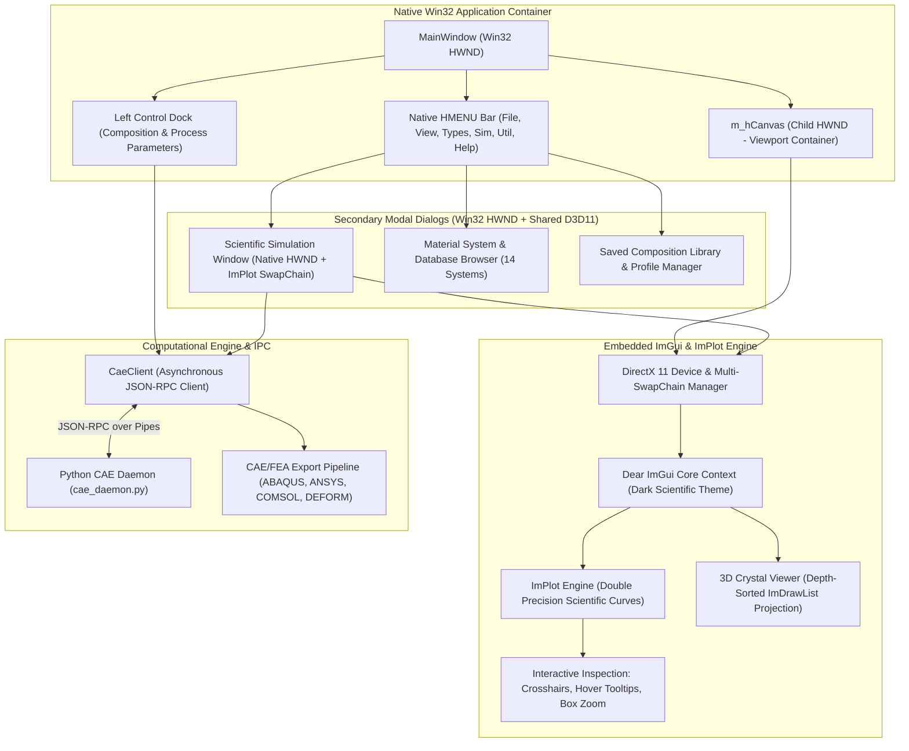

# RFC-042: Native C/C++ CAE Platform with Embedded Dear ImGui & ImPlot Graphics Layer

- **Author**: Jane (Senior Software Engineering Collaborator & Systems Architect)
- **Status**: Draft (Under Builder Check Review)
- **Date**: 2026-11-14
- **Target Platform**: Windows 11 x64 (MSVC 2026 / C++20 / DirectX 11 / Native Win32)
- **Target Repository**: `C:\Users\Dell\Documents\Material design\cpp\`

---

## 1. Context & Problem Statement

The computational materials engineering platform `CALPHADHEACalc` currently operates with two distinct frontend implementations:
1. A C# WPF desktop application (`csharp/`) equipped with comprehensive menu hierarchies, modal scientific simulation dialogs (e.g. creep, fatigue, TTT/CCT, and concentration sweeps), card-based material system selectors, persistent composition profiling, and automated multi-format CAE/FEA export pipelines.
2. A high-performance native C/C++ suite (`cpp/`) built atop Win32 and GDI+, which offers rapid startup and low memory overhead but currently lacks interactive plot inspection (coordinate hovering, box-zooming, real-time panning), secondary simulation dialogs, and feature parity with the C# desktop interface.

The goal of this design is to transition the C/C++ frontend to full parity with the C# desktop platform by embedding an immediate-mode Dear ImGui and ImPlot graphics layer inside the native Win32 window architecture, powered by DirectX 11. This delivers fluid $60\text{ fps}$ interactive plotting, precise crosshair coordinate readouts, interactive simulation windows, and multi-format engineering export capabilities without sacrificing the native binary footprint.

---

## 2. Explicit Non-Goals

1. **Non-Goal 1: Replacement of the Multi-Physics Python CAE Daemon**: The computational thermodynamic calculations, CALPHAD Gibbs energy minimizations, and numerical kinetics will continue to be executed by `pycalphad_app.server.cae_daemon`. The C++ application will not re-implement CALPHAD minimization algorithms natively.
2. **Non-Goal 2: Full Cross-Platform Windowing Abstraction**: This RFC targets the Windows desktop environment directly using native Win32 and DirectX 11. Abstracting windowing layers for Linux (X11/Wayland) or macOS (Metal) is explicitly outside the scope of this milestone.
3. **Non-Goal 3: In-Process Python Embedding via CPython C-API**: The client-server communication will strictly retain asynchronous JSON-RPC IPC over standard I/O pipes rather than linking directly against `python312.lib`, preventing GIL lockups and ensuring UI thread isolation.

---

## 3. Architecture & System Flow

### 3.1 High-Level Component Topology

### 3.2 Resolved Architectural Decisions (Builder Specifications)

1. **Secondary Dialog & Multi-SwapChain Architecture**:
   - Secondary modal dialogs (`ScientificSimulationDialog`, `DatabaseSelectorDialog`, `CompositionLibraryDialog`) are instantiated as native Win32 top-level modal dialog windows (`WS_POPUPWINDOW | WS_CAPTION | WS_SYSMENU | WS_THICKFRAME`) parented to `MainWindow`.
   - `ScientificSimulationDialog` contains a child canvas HWND backed by a secondary swapchain (`IDXGIFactory::CreateSwapChainForHwnd`) sharing the central `ID3D11Device`, running its own local `ImGuiContext` and `ImPlotContext`. This preserves native multi-monitor dragging, window docking, and OS-level modality while providing identical ImPlot interactive plotting.
2. **Tab 6 (3D Crystal Viewer) Rendering via `ImDrawList`**:
   - Tab 6 employs software orthographic/perspective projection with depth sorting (reusing the mathematical coordinate models from `Crystal3DViewer.cpp`) mapped directly to GPU-accelerated vector primitives via `ImDrawList::AddCircleFilled`, `ImDrawList::AddLine`, and `ImDrawList::AddText`. This delivers antialiased 60 fps atom spheres, Frank-Kasper coordination polyhedra bonds, and element labels without introducing heavyweight HLSL shader compiler dependencies.
3. **Central Workspace & Tab Ownership**:
   - `m_hCanvas` occupies the entire central client area. The 9 analysis tabs are authored using immediate-mode `ImGui::BeginTabBar("ScientificTabs")` inside the dark scientific canvas.
   - When Tab 6 is active, 3D controls (Element labels checkbox, Phase selection dropdown, Rotate 180°, Auto-spin, Reset view, Export PNG) are rendered as immediate-mode ImGui toolbar widgets, eliminating Win32 child window clipping and visual style fragmentation.

### 3.3 Viewport Rendering Pipeline

1. **Initialization**:
   - `MainWindow::create` registers `PyCALPHAD_NativeSuite_MainClass` and creates the parent `m_hwnd`.
   - `m_hCanvas` is instantiated as a child window (`WS_CHILD | WS_VISIBLE | WS_CLIPSIBLINGS`).
   - `DirectX11Renderer::initialize(m_hCanvas)` creates the `ID3D11Device`, `ID3D11DeviceContext`, and `IDXGISwapChain`.
   - `ImGui::CreateContext()` and `ImPlot::CreateContext()` initialize the immediate-mode pipeline with high-DPI font atlases and dark scientific palettes.
2. **Event Loop & Rendering**:
   - Windows messages (`WM_SIZE`, `WM_LBUTTONDOWN`, `WM_MOUSEMOVE`, `WM_MOUSEWHEEL`) on `m_hCanvas` are intercepted by `ImGui_ImplWin32_WndProcHandler`.
   - On each render pass, `ImPlot` renders the active tab's scientific datasets with logarithmic/linear axes, auto-fit boundaries, and real-time cursor hover values.
   - `IDXGISwapChain::Present(1, 0)` synchronizes presentation to the monitor refresh rate with zero tearing.

---

## 4. Evaluated Approaches & Trade-Off Matrix

| Evaluation Criterion | Approach 1: Pure Win32 + GDI+ | Approach 2: Native Win32 + ImGui/ImPlot (Selected) | Approach 3: Qt 6 C++ Framework |
| :--- | :--- | :--- | :--- |
| **Interactive Plot Inspection** | Manual hit-testing; high implementation complexity for tooltips & box zoom. | **Native feature of ImPlot**: built-in crosshairs, coordinate readouts, box zoom, and pan. | Built-in via QCustomPlot or Qt Charts. |
| **External Dependencies** | Zero external dependencies. | Single lightweight C++ source inclusion (ImGui + ImPlot + DX11 SDK). | Massive external framework (50+ MB DLLs, moc preprocessor). |
| **Rendering Performance** | Software CPU rasterization via GDI+ (~15-30 fps under heavy point clouds). | **Hardware-accelerated DirectX 11** (60+ fps sustained, immediate-mode). | Hardware-accelerated OpenGL/Vulkan/RHI. |
| **Binary Footprint** | ~780 KB single executable. | **~1.4 MB single executable**, statically compiled. | 60+ MB runtime redistributable. |
| **Scientific Visuals** | Static styled lines, limited real-time interaction. | **Professional scientific styling**, dual-axis scaling, dynamic markers. | High flexibility, high configuration overhead. |

**Selection Rationale**: Approach 2 delivers professional CAE scientific plotting with hardware-accelerated interactive inspection while preserving the single-binary deployment model and avoiding the heavyweight runtime footprint of Qt.

---

## 5. Operational Invariants & Edge Cases

1. **DirectX 11 Device Loss / Reset**: When a display mode changes or GPU driver restarts (`DXGI_ERROR_DEVICE_RESET`), the renderer must release all swapchain buffers, re-create the D3D11 device, and rebind ImGui textures without crashing the host application.
2. **Thread Safety of Asynchronous CAE Daemon Calls**: All solver responses and telemetry lines arriving from the background worker thread must be queued onto the main Win32 message loop via `PostMessageW(WM_CAE_RESULT)` or thread-safe message queues, ensuring that ImGui state mutations occur exclusively on the UI render thread.
3. **High-DPI Display Scaling**: The ImGui font atlas and UI element padding must scale dynamically based on `GetDpiForWindow(m_hwnd)`, ensuring crisp typography on 4K/high-density monitors.
4. **Fallback Mechanism**: In headless or virtualized Windows environments where hardware D3D11 acceleration is unavailable, the renderer must fall back to the WARP software rasterizer (`D3D_DRIVER_TYPE_WARP`).
5. **Memory Management for Large Continuous Datasets**: XRD diffractograms (~4,000 points) and continuation solver curves must be stored in contiguous `std::vector<double>` buffers and referenced via `ImPlot::PlotLine` striding pointers to eliminate data duplication.

---

## 6. Acceptance Criteria (Behavior-Driven Development)

### Scenario 1: Interactive Plot Inspection & Tooltip Readout
- **Given** the user has executed an equilibrium calculation for an alloy system,
- **When** the user switches to the "Mechanical Properties" or "Phase Equilibrium" tab and hovers the mouse cursor over a phase boundary curve,
- **Then** ImPlot must display an interactive crosshair with a floating tooltip indicating the exact temperature ($T$ in K or °C) and phase fraction/yield strength value, and allow mouse-wheel zooming and right-click panning.

### Scenario 2: Launching and Executing Secondary Simulation Solvers
- **Given** the main application is running with an active alloy composition,
- **When** the user selects `Calculations -> Creep Modeling...` or `Calculations -> Concentration Stepping...` from the top menu,
- **Then** a modal scientific simulation dialog must appear displaying parameters for that solver, execute the calculation through `CaeClient`, and render the resulting curves interactively in an ImPlot canvas within that dialog.

### Scenario 3: Material Database Browser & Saved Composition Library
- **Given** the user wishes to select a predefined alloy from the COST507 Light Alloys or Nickel Superalloy databases,
- **When** the user selects `Material Types -> Select Active Database...`,
- **Then** a visual browser must display the 14 available databases with their respective element sets, and selecting a database must automatically populate the left composition list with default presets.
- **When** the user clicks `Save Composition...`,
- **Then** the composition profile must be written to `saved_compositions.json` with a custom label, notes, and timestamps.

### Scenario 4: Multi-Format CAE & FEA Export
- **Given** a completed multi-physics calculation,
- **When** the user invokes `File -> Export to ABAQUS (*MATERIAL)...` or `File -> Export to COMSOL...`,
- **Then** the application must format and export verified material cards containing temperature-dependent elasticity, thermal expansion, thermal conductivity, and plastic flow stress curves into valid text formats.

---

## 7. Migration & Rollback Plan

- **Coexistence**: The existing GDI+ `PlotRenderer` will remain in the codebase as a fallback mode (`--use-gdi`) during the integration phase.
- **Rollback Path**: If DirectX 11 or ImGui initialization fails on legacy hardware, the application will automatically catch the initialization exception, log an informative warning, and initialize the GDI+ viewport.
- **Source Structure**:
  - `cpp/third_party/imgui/`: Core Dear ImGui library files.
  - `cpp/third_party/implot/`: ImPlot scientific plotting library files.
  - `cpp/src/DirectX11Renderer.cpp` & `cpp/include/DirectX11Renderer.hpp`: D3D11 swapchain and ImGui lifecycle manager.
  - `cpp/src/ImPlotViewport.cpp` & `cpp/include/ImPlotViewport.hpp`: Implementation of the 9 analysis tabs using ImPlot.
  - `cpp/src/SimulationDialog.cpp` & `cpp/include/SimulationDialog.hpp`: Modal simulation window engine.
  - `cpp/src/CompositionLibrary.cpp` & `cpp/include/CompositionLibrary.hpp`: Persistent composition manager.
  - `cpp/src/CaeExportEngine.cpp` & `cpp/include/CaeExportEngine.hpp`: Material card generators.
